<div align="center">

# 📊 Telecom Customer Churn Prediction

**An end-to-end machine learning application that predicts customer churn using four models and presents the results in an interactive Streamlit dashboard.**

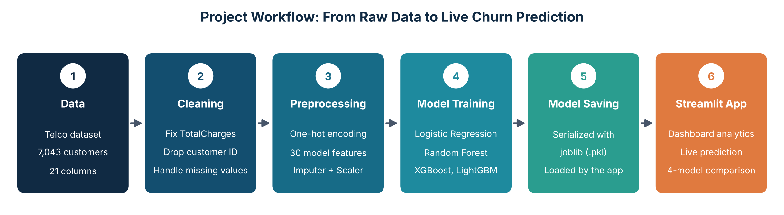

[Overview](#-overview) •
[How It Works](#-how-it-works) •
[Features](#-key-features) •
[Insights](#-key-insights) •
[Screenshots](#-application-walkthrough) •
[Architecture](#-system-architecture) •
[Setup](#-getting-started) •
[Author](#-author)

</div>

---

## 📌 Overview

Acquiring a new telecom customer costs far more than retaining an existing one. This project identifies customers who are likely to leave, so retention actions such as offers, outreach and contract upgrades can be taken **before** they churn.

The app lets a user explore churn patterns on a dashboard, enter any customer's profile, and instantly compare churn probabilities from **Logistic Regression, Random Forest, XGBoost and LightGBM**.

| | |
|---|---|
| **Domain** | Telecom / Customer Analytics |
| **Problem type** | Binary classification (churn vs retained) |
| **Dataset** | Telco Customer Churn, 7,043 records, 21 original columns |
| **Model features** | 30 (after one-hot encoding) |
| **Models** | Logistic Regression, Random Forest, XGBoost, LightGBM |
| **Interface** | Streamlit multi-page dashboard |

## 🔄 How It Works

| Step | Stage | What happens |
|:---:|---|---|
| 1 | **Data** | Telco Customer Churn dataset with 7,043 customers and 21 columns |
| 2 | **Cleaning** | Fix invalid `TotalCharges`, drop the customer ID, handle missing values |
| 3 | **Preprocessing** | One-hot encoding into 30 features, imputation, and scaling of `tenure`, `MonthlyCharges`, `TotalCharges` |
| 4 | **Model training** | Logistic Regression, Random Forest, XGBoost and LightGBM |
| 5 | **Model saving** | Trained models, imputer and scaler saved as `.pkl` files with `joblib` |
| 6 | **Streamlit app** | Dashboard analytics, live customer prediction and 4-model comparison |

## ✨ Key Features

- 📈 **Interactive dashboard** with KPI cards, churn distribution, contract analysis and feature distributions
- 🤖 **Multi-model prediction**: four trained models compared on every input
- 🎯 **Average churn probability** with a clear stay / churn verdict
- 🔁 **Consistent preprocessing**: the same encoding, imputation and scaling used in training is applied at prediction time
- 🎨 **Clean UI** with custom styling and a sidebar navigation

## 📊 Key Insights

| Metric | Value |
|---|---|
| Total customers | 7,043 |
| Churned customers | 1,869 |
| Overall churn rate | **26.5%** |
| Average monthly charges | $64.76 |

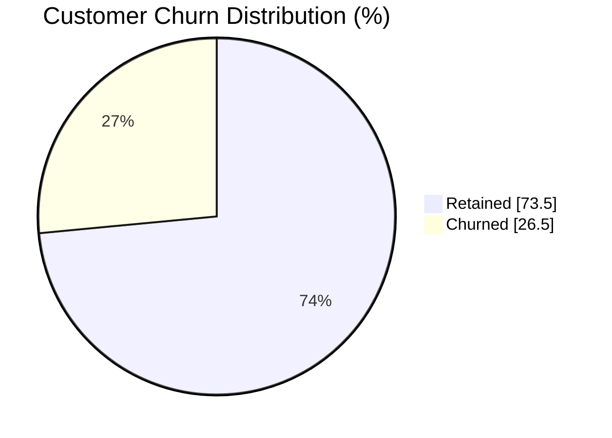

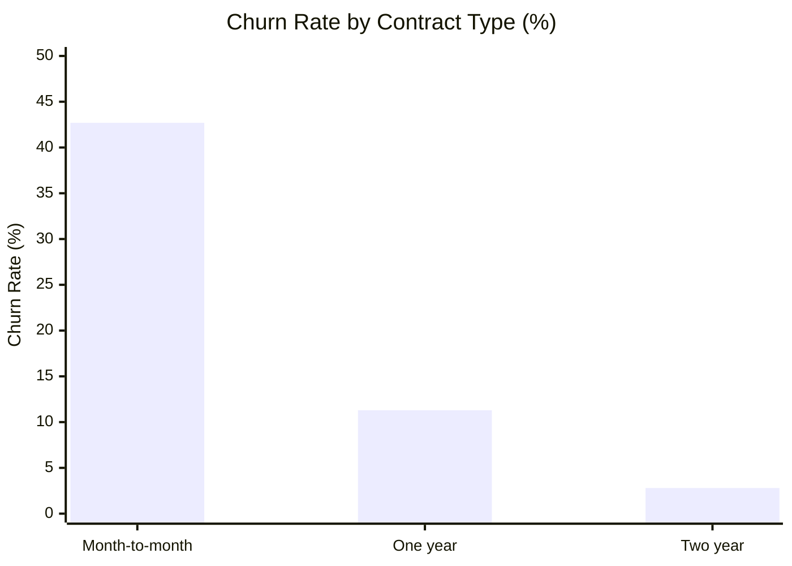

> **Key finding:** month-to-month customers churn at **42.7%**, roughly **15x** the rate of two-year contract customers (2.8%). Moving customers to longer contracts is one of the most effective retention levers.

---

## 🖼️ Application Walkthrough

The app has three pages, reachable from the sidebar: **Dashboard**, **Customer Prediction** and **About Project**.

### 1. Dashboard: Business Overview

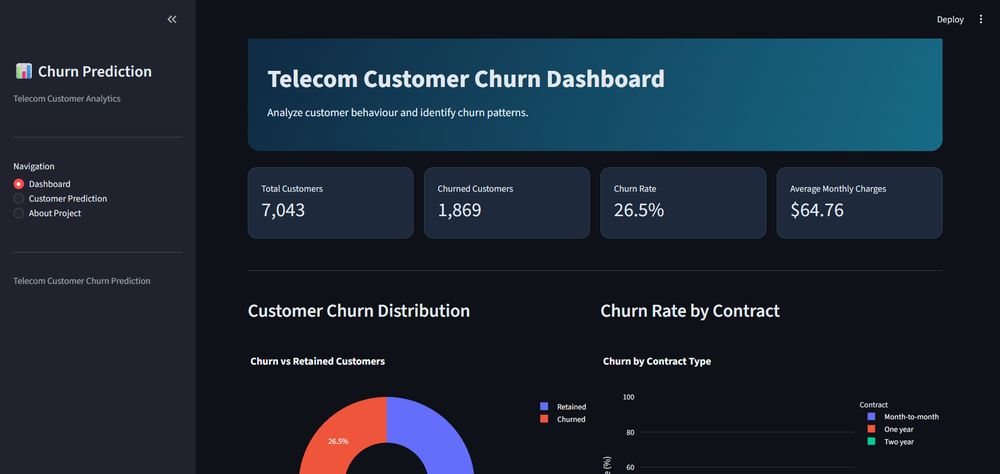

Four KPI cards summarize the dataset at a glance: **7,043** customers, **1,869** churned, **26.5%** churn rate and **$64.76** average monthly charges.

### 2. Churn Distribution and Contract Analysis

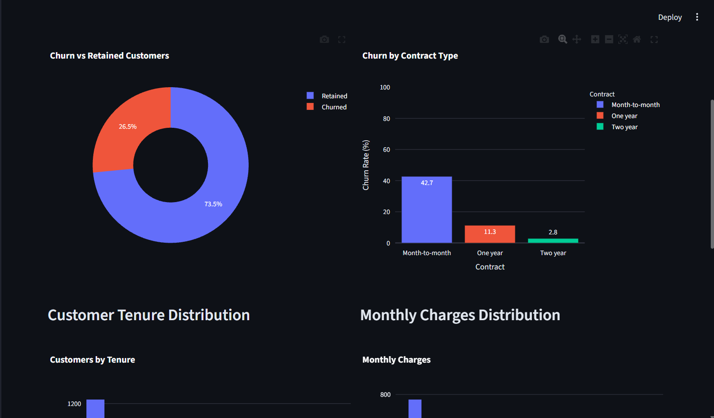

The donut chart shows 26.5% churned vs 73.5% retained. The contract chart reveals the strongest churn signal: **42.7%** for month-to-month, **11.3%** for one-year and **2.8%** for two-year contracts.

### 3. Tenure and Monthly Charges Distribution

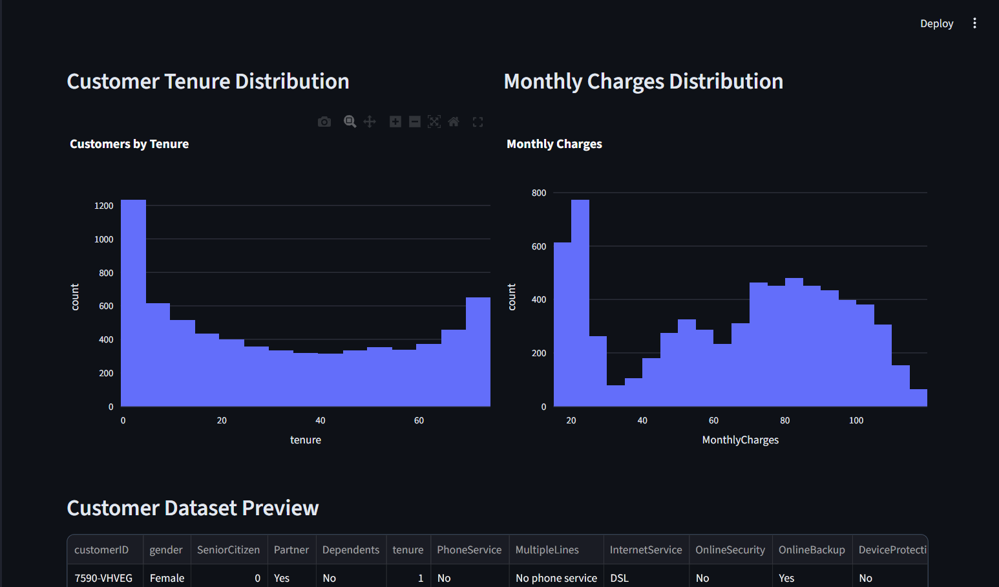

Many customers are very new (first few months) while another large group has stayed 60+ months. Monthly charges form two clusters: low-cost basic plans, and a wider group around $70 to $100 with multiple services.

### 4. Customer Dataset Preview

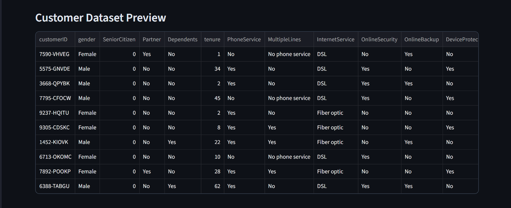

A scrollable table of the cleaned records so users can inspect the data behind every chart.

### 5. Customer Prediction: Input Form

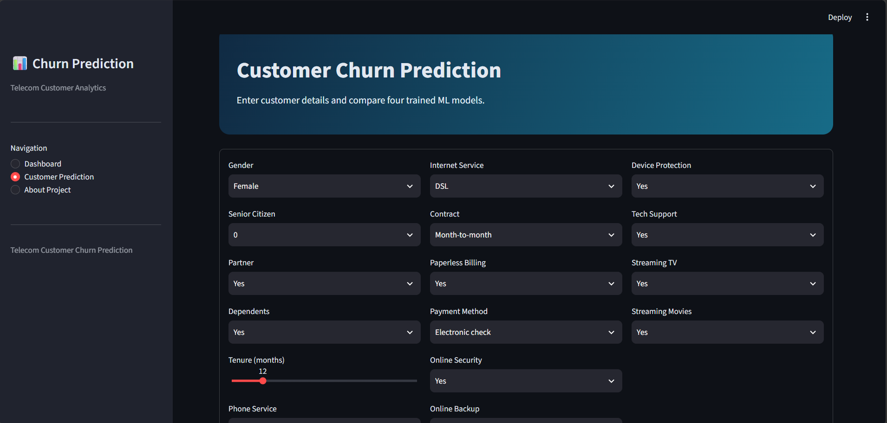

Users enter demographics, account details (tenure, contract, billing, payment method) and subscribed services through dropdowns and a slider. On **Predict Churn**, the input passes through the training preprocessing pipeline before reaching the models.

### 6. Model Prediction Results

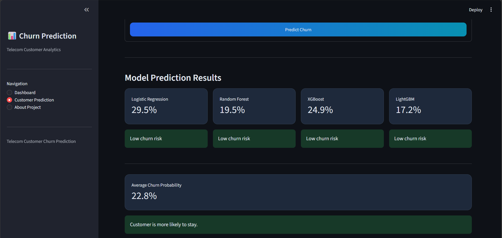

Each model returns its own churn probability with a risk label. The average probability gives the final verdict.

| Model | Churn probability |
|---|---|
| Logistic Regression | 29.5% |
| Random Forest | 19.5% |
| XGBoost | 24.9% |
| LightGBM | 17.2% |
| **Average** | **22.8%: customer is more likely to stay** |

### 7. Model-wise Comparison Chart

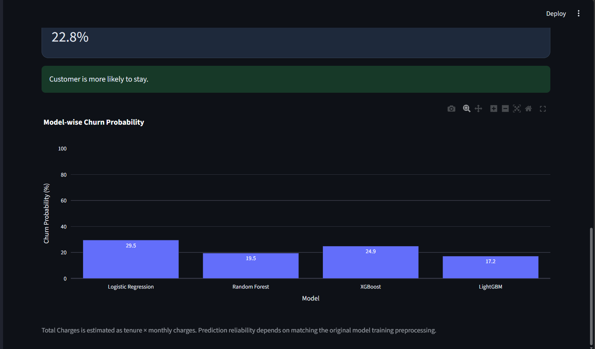

An interactive Plotly chart compares all four models side by side. In the prediction form, Total Charges is estimated as tenure × monthly charges.

### 8. About Project Page

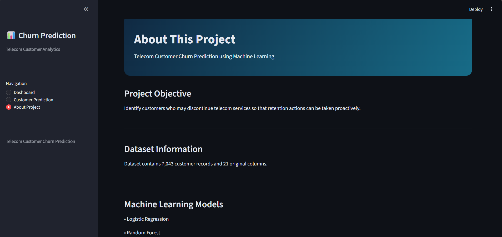

Documents the objective, dataset, models, technology stack and business value.

---

## 🏗️ System Architecture

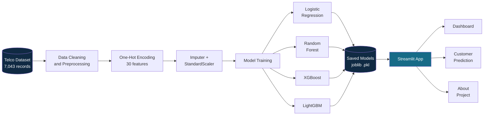

### Prediction Flow

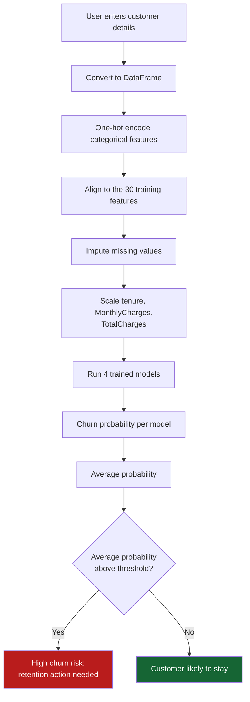

## 🧠 Machine Learning Workflow

1. **Data:** Telco Customer Churn dataset (7,043 records, 21 columns)
2. **Cleaning:** handled invalid `TotalCharges` values and dropped identifier columns
3. **Encoding:** one-hot encoding of categorical features, giving 30 model features
4. **Imputation and scaling:** imputer on the feature set; `StandardScaler` on `tenure`, `MonthlyCharges` and `TotalCharges`
5. **Modeling:** four classifiers trained and saved with `joblib`
6. **Deployment:** Streamlit app loads the saved models and serves predictions

## 🛠️ Tech Stack

| Area | Tools |
|---|---|
| Language | Python |
| Data processing | Pandas, NumPy |
| Machine learning | Scikit-learn, XGBoost, LightGBM |
| Visualization | Plotly |
| Web app | Streamlit |
| Model persistence | Joblib |

## 📁 Project Structure

```
Customer Churn Prediction/
├── app.py                          # Streamlit application
├── requirements.txt                # Pinned dependencies
├── data/
│   └── processed/
│       └── telco_churn_cleaned.csv # Cleaned dataset
├── models/
│   ├── logistic_regression.pkl
│   ├── random_forest.pkl
│   ├── xgboost.pkl
│   ├── lightgbm.pkl
│   ├── imputer.pkl
│   └── scaler.pkl
├── screenshots/                    # README images
└── README.md
```

## 🚀 Getting Started

```bash
# 1. Clone the repository
git clone https://github.com/shubhamdeshmukh1027/customer-churn-prediction.git
cd customer-churn-prediction

# 2. Create and activate a virtual environment
python -m venv .venv
.venv\Scripts\activate          # Windows
# source .venv/bin/activate     # macOS / Linux

# 3. Install dependencies
python -m pip install -r requirements.txt

# 4. Run the app
python -m streamlit run app.py
```

Open `http://localhost:8501` in your browser.

## 💼 Business Value

- Prioritize **high-risk customers** for retention campaigns
- Identify which **contract types, services and tenure ranges** drive churn
- Compare multiple models instead of relying on a single prediction
- Reduce revenue loss by acting before customers leave

## ⚠️ Limitations

- `TotalCharges` in the prediction form is **estimated as tenure × monthly charges**
- The Telco dataset is a public benchmark, not live company data

## 🔮 Future Improvements

- [ ] Hyperparameter tuning and cross-validation reporting
- [ ] Class imbalance handling (SMOTE / class weights)
- [ ] SHAP-based explanations for individual predictions
- [ ] Batch prediction via CSV upload
- [ ] Public cloud deployment with a live demo link

---

## 👨‍💻 Author

**Shubham Deshmukh**
B.Tech, Artificial Intelligence & Data Science, Sanjivani University
Aspiring ML / Data Engineer

🔗 [GitHub Profile](https://github.com/shubhamdeshmukh1027)

<div align="center">

⭐ If you found this project useful, consider giving it a star.

</div>
